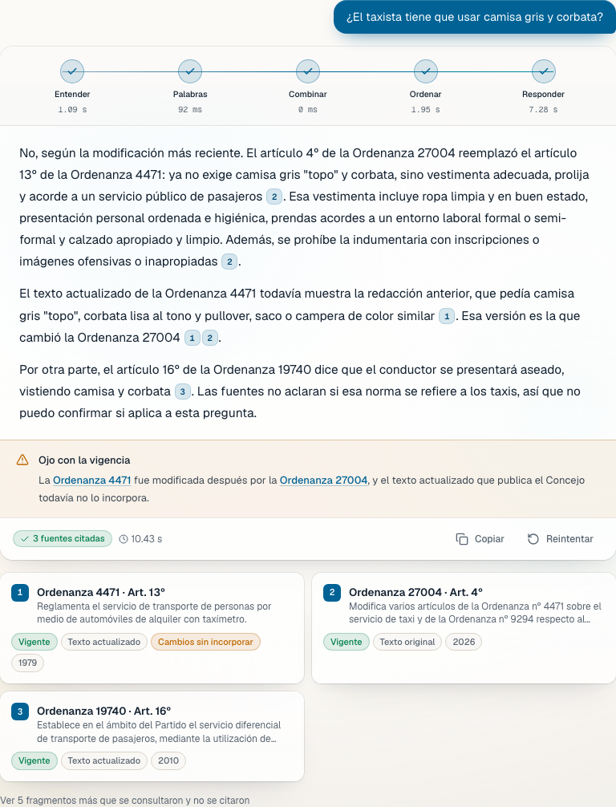
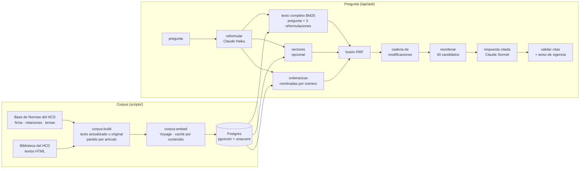

# Digesto Abierto

**Las ordenanzas de Mar del Plata, respondidas con el artículo exacto y su vigencia.**

[](https://digesto-abierto.vercel.app)
[](https://github.com/MatheoTe/digesto-abierto/actions/workflows/ci.yml)


Preguntás como le preguntarías a alguien —*¿qué necesito para habilitar un food truck?*, *¿cuántas horas tiene que trabajar un taxi?*, *¿sigue vigente la Ordenanza 15043?*— y Digesto Abierto responde con el artículo exacto de la ordenanza, el link al texto oficial del Concejo Deliberante y un aviso si esa norma fue derogada o modificada después del texto publicado.



## Por qué

Las ordenanzas de General Pueyrredon son públicas, pero están en miles de archivos sueltos y muchas fueron modificadas varias veces. Para saber qué dice *hoy* una norma hay que seguir esa cadena a mano. Un chatbot general no tiene esos textos: en nuestra medición, el mismo modelo sin el digesto nombró la ordenanza correcta en el 15% de las preguntas y en el resto contestó que no sabía (ver [Evaluación](#evaluación)).

Digesto Abierto hace tres cosas que un chatbot no:

- **Cita el artículo exacto.** Cada oración lleva su cita; tocarla abre el artículo con la frase que la respalda resaltada y el link al texto oficial. El servidor descarta cualquier cita a un fragmento que no se le dio al modelo.
- **Sigue la vigencia.** Cada ordenanza se cruza con su ficha oficial: si fue abrogada no se usa como regla vigente, y si la Base de Normas registra una modificación más nueva que las que incorpora el texto actualizado, la respuesta lo avisa y enlaza la ordenanza que la modificó.
- **Dice "no lo encontré".** Si el digesto no responde la pregunta, lo dice en vez de completar con lo que "suele" decir una norma.

## Cómo funciona



- **Datos.** `scripts/crawl/` baja, de a pocas peticiones y respetando el `robots.txt`, la ficha de cada ordenanza (resumen, fechas, alcance, abrogación), su página en la Base de Normas (temas y relaciones: qué modifica, qué deroga, quién la modificó) y su texto. Si la Biblioteca publica un *texto actualizado* se usa ese; si no, el original. Todo queda crudo en `data/raw/` y se procesa aparte, así se puede re-procesar sin volver a pedir nada.
- **Unidad de cita: el artículo.** `src/server/corpus/segment.ts` parte cada texto por artículo (con `bis`, `ter`, anexos), arrastra el título y capítulo, conserva las notas "(Ordenanza 6089, art. 1º)" que marcan de dónde viene cada modificación y descarta firmas y fundamentos. Cada ordenanza suma además una *ficha* con su estado, que es lo que responde "¿sigue vigente?".
- **Búsqueda.** Texto completo en Postgres con una configuración `es_unaccent` (stemming en español sin tildes: *habilitación* = *habilitacion*) y un ranking tipo BM25: cada término suma su IDF (tabla `term_stats`), así "taxi" pesa más que "trabajo" y los anexos de presupuesto, que nombran de todo, no ganan. Se busca con la pregunta tal cual y con tres reformulaciones (palabras de la pregunta, vocabulario de ordenanza, nombres formales de lo coloquial); si la pregunta nombra una ordenanza, también adentro de ella; y opcionalmente por significado con pgvector. Los rankings se fusionan con Reciprocal Rank Fusion y un reranker (Voyage o Claude Haiku) ordena los 40 mejores.
- **Cadena de modificaciones.** Si entre los candidatos aparece un artículo de una ordenanza modificada después, se suma el artículo de la ordenanza posterior que lo reescribió ("Modifícase el Artículo 13º de la Ordenanza Nº 4471…"), aunque el texto actualizado oficial todavía no lo incorpore.
- **Respuesta.** Claude responde solo con los fragmentos numerados, cita cada oración y conoce el estado de cada fuente (vigente, texto actualizado u original, modificaciones no incorporadas). Las preguntas de seguimiento usan la conversación para reformular.
- **Costos acotados.** Cada pregunta queda registrada con su costo; el sitio deja de responder por el día al llegar a un tope configurable (`DIGESTO_DAILY_BUDGET_USD`) y limita preguntas por persona.

## Evaluación

`eval/golden.json` tiene preguntas reales con su respuesta verificada a mano contra el texto oficial, incluidas preguntas que el digesto no responde. `npm run eval` corre el pipeline completo sobre el corpus real y, como línea de base, le hace las mismas preguntas al mismo modelo sin el digesto.

<!-- EVAL:START -->
Última corrida: 22/10/2026, sobre las 22.470 ordenanzas de la base (24 preguntas: 20 con respuesta y 4 sin respuesta en el digesto).

| | Digesto Abierto | Mismo modelo sin el digesto |
|---|---|---|
| Responde citando la ordenanza correcta | **80%** | 15% |
| Incluye los datos clave de la respuesta verificada | **85%** | 20% |
| Encuentra el artículo correcto entre los 8 primeros | 80% | — |
| Dice "no lo encontré" cuando el digesto no responde | **100%** | — |
| Se abstiene cuando sí había respuesta | 5% | — |
| Afirmaciones respaldadas por la fuente citada (juez: Claude Haiku) | 95% | — |

Costo medio por respuesta: US$ 0,019. Sin el digesto, el modelo casi siempre contesta que no sabe: no inventa, pero tampoco responde. El caso que mejor lo muestra es *¿El taxista tiene que usar camisa gris y corbata?*: el texto actualizado que publica el Concejo todavía exige camisa gris "topo" y corbata, pero la Ordenanza 27004 (junio de 2026) reemplazó ese artículo por "vestimenta adecuada". Digesto Abierto responde con los dos artículos y avisa el cambio.

Esta corrida es **solo por palabras** (sin vectores): Claude reformula la pregunta y Claude Haiku reordena. Con `VOYAGE_API_KEY` se suma la búsqueda por significado sobre las ordenanzas generales y las fichas de todas.
<!-- EVAL:END -->

## Correrlo

Requiere Node 24 y Postgres 17 con pgvector (`docker compose up -d` levanta uno).

```bash
npm install
cp .env.example .env          # ANTHROPIC_API_KEY y VOYAGE_API_KEY (sin claves funciona offline)
npm run db:migrate
npm run crawl                 # baja el corpus a data/raw/ (lleva unas horas; es reanudable)
npm run corpus:build          # ordenanzas, fichas y artículos a la base
npm run corpus:embed          # vectores de las ordenanzas vigentes
npm run dev                   # http://localhost:3000
```

Tests: `npm test` (unitarios + integración contra Postgres; `createdb digesto_test`), `npm run test:e2e` (Playwright sobre un digesto ficticio de prueba), `npm run eval` (calidad sobre el corpus real, usa las APIs).

## Estructura

```
scripts/crawl/         bajada de fichas, textos y relaciones (reanudable, de a pocas peticiones)
scripts/corpus-*.ts    armado del corpus y de los vectores
src/server/corpus/     HTML → texto, partición por artículo, fichas y vigencia
src/server/retrieval/  búsqueda híbrida, RRF, ordenanzas nombradas
src/server/generation/ prompt y pipeline de respuesta con trazas y costos
src/app/               sitio: preguntar, /ordenanza/[numero], /como-funciona
eval/                  set de preguntas verificadas y arnés de evaluación
tests/                 unitarios, integración (Postgres) y E2E (Playwright)
```

## Límites

- No es un sitio oficial ni asesoramiento legal. Tiene validez legal lo publicado en el Boletín Oficial Municipal.
- El Concejo publica el texto completo de todas las ordenanzas desde la 10.000 y de las anteriores de carácter general; del resto hay solo ficha.
- Por ahora, solo ordenanzas: decretos, resoluciones y normativa provincial o nacional quedan afuera.

## Créditos

Datos: [Base de Normas](https://basenormas.concejomdp.gov.ar) y Biblioteca del Honorable Concejo Deliberante de General Pueyrredon. Hecho en Mar del Plata por [Matheo Telesca](https://github.com/MatheoTe), a partir de [Citevia](https://github.com/MatheoTe/citevia). Licencia MIT.
