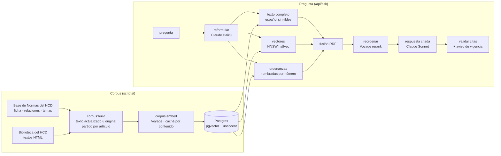

# Digesto Abierto

**Las ordenanzas de Mar del Plata, respondidas con el artículo exacto y su vigencia.**

[](https://digesto-abierto.vercel.app)
[](https://github.com/MatheoTe/digesto-abierto/actions/workflows/ci.yml)


Preguntás como le preguntarías a alguien —*¿qué necesito para habilitar un food truck?*, *¿cuántas horas tiene que trabajar un taxi?*, *¿sigue vigente la Ordenanza 15043?*— y Digesto Abierto responde con el artículo exacto de la ordenanza, el link al texto oficial del Concejo Deliberante y un aviso si esa norma fue derogada o modificada después del texto publicado.


## Por qué

Las ordenanzas de General Pueyrredon son públicas, pero están en miles de archivos sueltos y muchas fueron modificadas varias veces. Para saber qué dice *hoy* una norma hay que seguir esa cadena a mano. Un chatbot general no la sigue: no tiene los textos, inventa números de ordenanza con seguridad y no sabe qué quedó derogado (ver [Evaluación](#evaluación)).

Digesto Abierto hace tres cosas que un chatbot no:

- **Cita el artículo exacto.** Cada oración lleva su cita; tocarla abre el artículo con la frase que la respalda resaltada y el link al texto oficial. El servidor descarta cualquier cita a un fragmento que no se le dio al modelo.
- **Sigue la vigencia.** Cada ordenanza se cruza con su ficha oficial: si fue abrogada no se usa como regla vigente, y si la Base de Normas registra una modificación más nueva que las que incorpora el texto actualizado, la respuesta lo avisa y enlaza la ordenanza que la modificó.
- **Dice "no lo encontré".** Si el digesto no responde la pregunta, lo dice en vez de completar con lo que "suele" decir una norma.

## Cómo funciona



- **Datos.** `scripts/crawl/` baja, de a pocas peticiones y respetando el `robots.txt`, la ficha de cada ordenanza (resumen, fechas, alcance, abrogación), su página en la Base de Normas (temas y relaciones: qué modifica, qué deroga, quién la modificó) y su texto. Si la Biblioteca publica un *texto actualizado* se usa ese; si no, el original. Todo queda crudo en `data/raw/` y se procesa aparte, así se puede re-procesar sin volver a pedir nada.
- **Unidad de cita: el artículo.** `src/server/corpus/segment.ts` parte cada texto por artículo (con `bis`, `ter`, anexos), arrastra el título y capítulo, conserva las notas "(Ordenanza 6089, art. 1º)" que marcan de dónde viene cada modificación y descarta firmas y fundamentos. Cada ordenanza suma además una *ficha* con su estado, que es lo que responde "¿sigue vigente?".
- **Búsqueda híbrida.** Texto completo en Postgres con una configuración `es_unaccent` (stemming en español sin tildes: *habilitación* = *habilitacion*), vectores en pgvector y, si la pregunta nombra una ordenanza, una tercera búsqueda dentro de ella. Los tres rankings se fusionan con Reciprocal Rank Fusion y un reranker ordena los mejores. Solo las ordenanzas vigentes tienen vector; las derogadas se alcanzan por número.
- **Respuesta.** Claude responde solo con los fragmentos numerados, cita cada oración y conoce el estado de cada fuente (vigente, texto actualizado u original, modificaciones no incorporadas). Las preguntas de seguimiento usan la conversación para reformular.
- **Costos acotados.** Cada pregunta queda registrada con su costo; el sitio deja de responder por el día al llegar a un tope configurable (`DIGESTO_DAILY_BUDGET_USD`) y limita preguntas por persona.

## Evaluación

`eval/golden.json` tiene preguntas reales con su respuesta verificada a mano contra el texto oficial, incluidas preguntas que el digesto no responde. `npm run eval` corre el pipeline completo sobre el corpus real y, como línea de base, le hace las mismas preguntas al mismo modelo sin el digesto.

<!-- EVAL:START -->
_Se completa con la primera corrida de `npm run eval`._
<!-- EVAL:END -->

## Correrlo

Requiere Node 24 y Postgres 17 con pgvector (`docker compose up -d` levanta uno).

```bash
npm install
cp .env.example .env          # ANTHROPIC_API_KEY y VOYAGE_API_KEY (sin claves funciona offline)
npm run db:migrate
npm run crawl                 # baja el corpus a data/raw/ (lleva unas horas; es reanudable)
npm run corpus:build          # ordenanzas, fichas y artículos a la base
npm run corpus:embed          # vectores de las ordenanzas vigentes
npm run dev                   # http://localhost:3000
```

Tests: `npm test` (unitarios + integración contra Postgres; `createdb digesto_test`), `npm run test:e2e` (Playwright sobre un digesto ficticio de prueba), `npm run eval` (calidad sobre el corpus real, usa las APIs).

## Estructura

```
scripts/crawl/         bajada de fichas, textos y relaciones (reanudable, de a pocas peticiones)
scripts/corpus-*.ts    armado del corpus y de los vectores
src/server/corpus/     HTML → texto, partición por artículo, fichas y vigencia
src/server/retrieval/  búsqueda híbrida, RRF, ordenanzas nombradas
src/server/generation/ prompt y pipeline de respuesta con trazas y costos
src/app/               sitio: preguntar, /ordenanza/[numero], /como-funciona
eval/                  set de preguntas verificadas y arnés de evaluación
tests/                 unitarios, integración (Postgres) y E2E (Playwright)
```

## Límites

- No es un sitio oficial ni asesoramiento legal. Tiene validez legal lo publicado en el Boletín Oficial Municipal.
- El Concejo publica el texto completo de todas las ordenanzas desde la 10.000 y de las anteriores de carácter general; del resto hay solo ficha.
- Por ahora, solo ordenanzas: decretos, resoluciones y normativa provincial o nacional quedan afuera.

## Créditos

Datos: [Base de Normas](https://basenormas.concejomdp.gov.ar) y Biblioteca del Honorable Concejo Deliberante de General Pueyrredon. Hecho en Mar del Plata por [Matheo Telesca](https://github.com/MatheoTe), a partir de [Citevia](https://github.com/MatheoTe/citevia). Licencia MIT.
